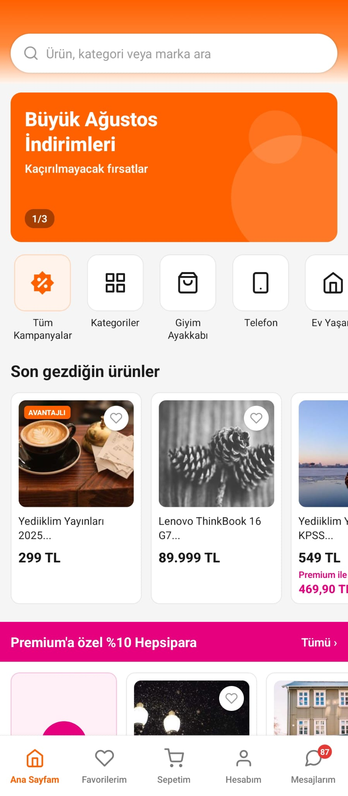
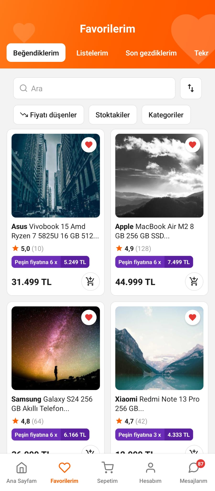
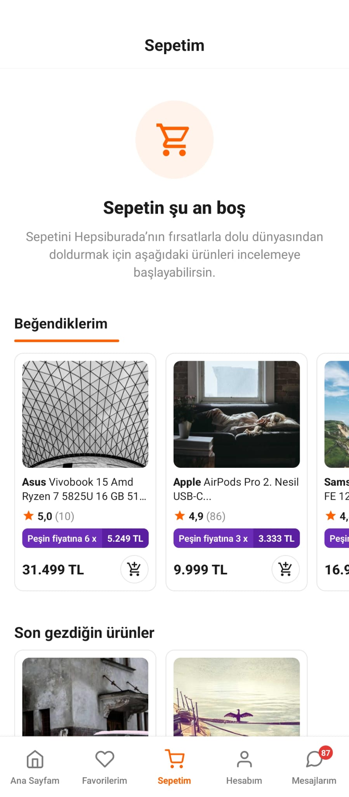
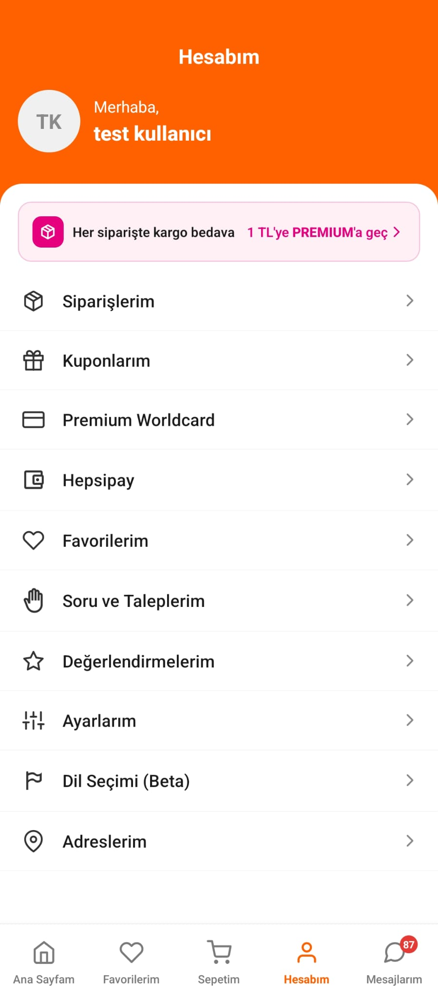
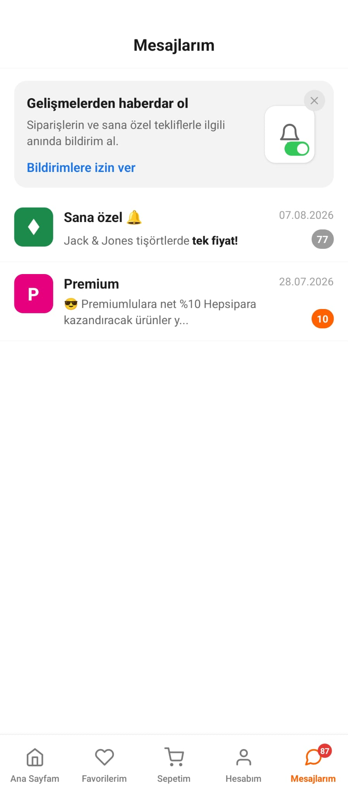

# Hepsiburada Clone

React Native ile geliştirilmiş **Hepsiburada** mobil uygulama klonu.

Splash ekranı, ana sayfa, favoriler, sepet, hesap ve mesajlar ekranlarını içerir. Navigasyon bottom tab + stack yapısıyla kuruludur.

## Ekran Görselleri

### Ana Sayfam

### Favorilerim

### Sepetim

### Hesabım

### Mesajlarım

## Özellikler

- Splash (Hepsiburada Premium branding)
- Ana sayfa: arama, kampanya banner, kategoriler, ürün listeleri, Premium alanı
- Favoriler: sekmeler, arama/filtre, 2 sütun ürün grid
- Sepet: boş sepet durumu + önerilen ürünler
- Hesap: profil, Premium banner, menü listesi
- Mesajlar: bildirim banner + mesaj listesi
- Bottom tab navigasyon (Ana Sayfam, Favorilerim, Sepetim, Hesabım, Mesajlarım)
